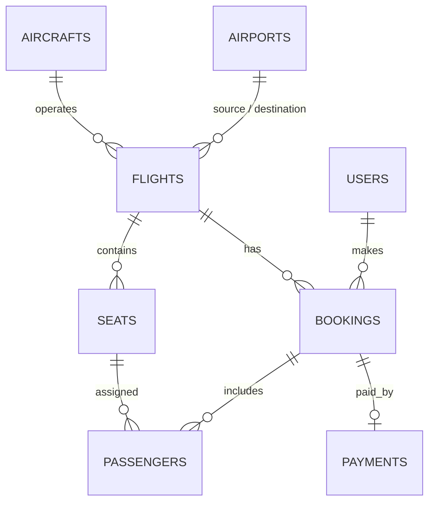

# SkyBook: Airline Ticketing System

Full-stack flight booking app. The core problem it solves: **two users trying to book the same seat at the same time**.

| Part | Tech |
|---|---|
| `backend/` | Java 17, Spring Boot 3, Spring Data JPA / Hibernate, MySQL, JDBC (`JdbcTemplate`), Spring Security + JWT, Swagger |
| `frontend/` | React 18, Vite, React Router |

## Features
- Sign up / log in (JWT), roles `USER` and `ADMIN`
- Search flights by route and date, live seat availability, interactive seat map
- Multi-passenger booking, 10-minute seat hold with countdown, mock payment, cancel with refund
- Concurrency-safe seats with optimistic locking (`@Version`) and a scheduled job that releases expired holds
- Admin panel: add airports, aircraft, flights; revenue report (plain JDBC)

## Run locally
```bash
# 1. backend + MySQL
docker compose up --build            # API on http://localhost:8080  (Swagger: /swagger-ui.html)
#    or without Docker: start MySQL, then  cd backend && mvn spring-boot:run

# 2. frontend
cd frontend
npm install
cp .env.example .env                 # VITE_API_URL=http://localhost:8080
npm run dev                          # http://localhost:5173
```
Demo data is seeded on first start. Admin login: `admin@airline.com` / `Admin@123`.

## Deploy
See [DEPLOY.md](DEPLOY.md) (Aiven MySQL + Render, or Vercel/Netlify for the website). `render.yaml` is included for one-step setup.

## Tests
```bash
cd backend && mvn test     # in-memory H2; includes a two-threads-one-seat race test
```

## How double booking is prevented
1. `Seat` has a `@Version` column; every update is `UPDATE ... WHERE id=? AND version=?`.
2. Two concurrent bookings read the same seat version. The first commit wins; the second matches 0 rows and Hibernate throws `ObjectOptimisticLockingFailureException`.
3. The exception handler returns HTTP **409** and the transaction rolls back, so no half-created booking remains.
4. The frontend shows the message and refreshes the seat map.

## Booking lifecycle
```
PENDING_PAYMENT --pay--------> CONFIRMED
PENDING_PAYMENT --10 min-----> EXPIRED      (scheduler frees the seats)
PENDING_PAYMENT/CONFIRMED --cancel--> CANCELLED (seats freed, payment REFUNDED)
```

## API overview
| Method | Path | Access |
|---|---|---|
| POST | `/api/auth/register`, `/api/auth/login` | public |
| GET | `/api/airports`, `/api/flights/search`, `/api/flights/{id}`, `/api/flights/{id}/seats` | public |
| POST | `/api/bookings`, `/api/bookings/{pnr}/pay`, `/api/bookings/{pnr}/cancel` | user |
| GET | `/api/bookings`, `/api/bookings/{pnr}` | user |
| POST/GET | `/api/admin/airports`, `/aircrafts`, `/flights`, `/reports/revenue` | admin |

## Data model

